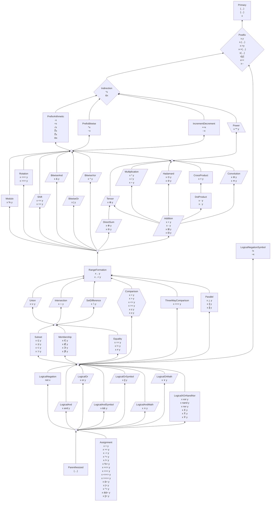
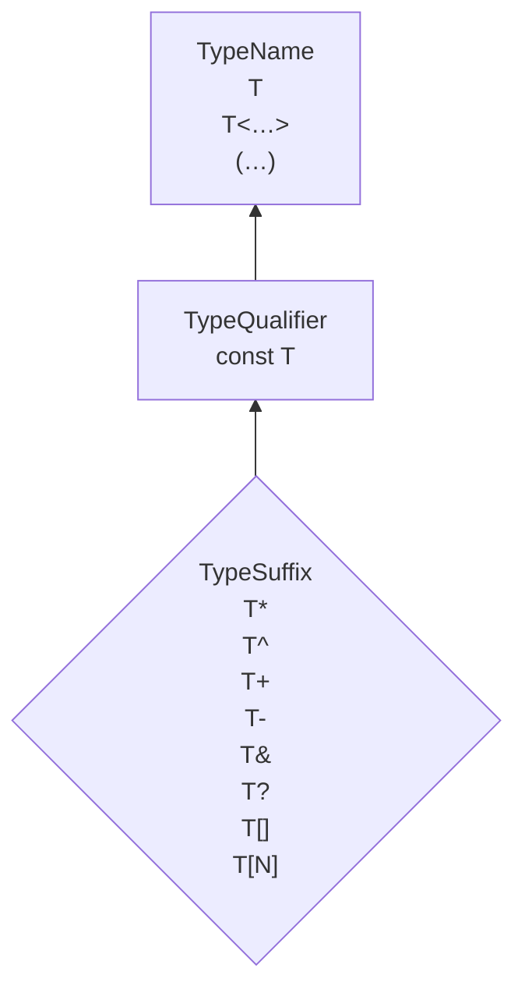
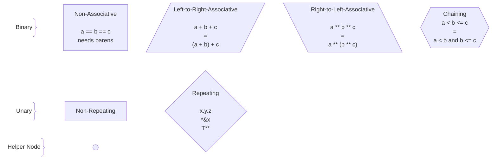

# Unfinished Ideas

Admittedly, many ideas for Cilia are not yet _fully_ developed, but these really do need some more work.


## `T^` to Objects of Other Languages

We can redefine `T^` for interoperability with other languages, e.g. garbage collected languages like C# and Java.

`T^` is defined via type traits `SharedPtrType`:
- For all C++/Cilia classes `T^` is `SharedPtr<T>`:  
  ```
  extension<type T> T {
      using SharedPtrType = SharedPtr<T>
  }
  ```
- Objective-C/Swift classes use their reference counting mechanism:
  ```
  class ObjectiveCObject {
      using SharedPtrType = ObjectiveCRefCountPtr
  }
  ```
- C#/.NET classes use garbage collected memory for instance/object allocation, add instance/object-pointers to the global list of C#/.NET instance pointers (with GCHandle and/or gcroot).  
  ```
  class DotNetObject {
      using SharedPtrType = DotNetGCPtr
  }
  ```
    - Access/dereferencing creates a temporary `DotNetGCPinnedPtr`, that pins the object (so the garbage collector cannot move it during access).
- Java classes use garbage collected memory, add pointers to the global list of Java instance pointers.  
  ```
  class JavaObject {
      using SharedPtrType = JavaGCPtr
  }
  ```
    - Probably very similar to C#/.NET.

`T+` is defined via type traits `UniquePtrType`:
- For C++/Cilia classes `T+` is `UniquePtr<T>`:
  ```
  extension<type T> T {
      using UniquePtrType = UniquePtr<T>
  }
  ```
- For Objective-C/Swift, C#/.NET, and Java the `UniquePtrType` will be very similar to the `SharedPtrType`, maybe even identical.


## Exotic Operators (e.g. Unicode)

### Logical / Bool Operators

It is also possible to use the mathematical symbols **`∧`**, **`∨`**, **`⊼`**, **`⊽`**, **`¬`** for `and`, `or`, `nand`, `nor`, `not`.
```
operator (Bool a) ∧ (Bool b) -> Bool { return a and b }
operator (Bool a) ∨ (Bool b) -> Bool { return a or b }
operator (Bool a) ⊼ (Bool b) -> Bool { return a nand b }
operator (Bool a) ⊽ (Bool b) -> Bool { return a nor b }
operator (Bool a) ⊻ (Bool b) -> Bool { return a xor b }
operator ¬(Bool a) -> Bool { return not a }
```


### Vector / Matrix Operators

```
operator (Vec3 a) × (Vec3 b) -> Vec3       { ... }   // cross product (beware of confusion with the letter 'x')
operator (Vec a) ⋅ (Vec b) -> Float        { ... }   // dot / scalar / inner product

operator (Matrix a) ⊙ (Matrix b) -> Matrix { ... }   // Hadamard (element-wise) product
operator (Matrix a) ⊘ (Matrix b) -> Matrix { ... }   // Hadamard (element-wise) division
operator (Matrix a) ⊞ (Matrix b) -> Matrix { ... }   // element-wise addition ("boxplus")
operator (Matrix a) ⊟ (Matrix b) -> Matrix { ... }   // element-wise subtraction ("boxminus")
operator (Matrix a) ⊗ (Matrix b) -> Matrix { ... }   // tensor / Kronecker product

operator (Vec a) ⊕ (Vec b) -> Vec          { ... }   // direct sum: {1 2} ⊕ {3 4} -> {1 2 3 4}
operator ⊖(Vec a) -> Vec                   { ... }   // negation (unary)
operator (Vec a) ⊖ (Vec b) -> Vec          { ... }   // subtraction (binary)
operator (Signal a) ⊛ (Signal b) -> Signal { ... }   // convolution
operator (Signal a) ∗ (Signal b) -> Signal { ... }   // convolution (alternative)

func ∠(Vec a, b) -> Float        { ... }  // angle between two vectors
func ∠(Point3D a, b, c) -> Float { ... }  // angle between three points (vectors ab and bc)
```

Unclear, if these should have an epsilon (ε) value here. And then they would be function calls, not infix operators:
```
operator (Vec a) ⟂ (Vec b) -> Bool { ... }   // perpendicular / orthogonal
operator (Vec a) ∥ (Vec b) -> Bool { ... }   // parallel to
operator (Vec a) ∦ (Vec b) -> Bool { ... }   // not parallel to
```

### Set Operators

Set operators fall into two precedence groups (see precedence diagram below). They are unrelated to scalar relational operators such as `==`, `!=`, `<`, or `>` — there is no precedence ordering between the two domains, and meaningful expressions do not mix them.

**Membership / subset** — `∈`, `∉`, `∋`, `∌`, `⊆`, `⊇`, `⊂`, `⊃` parse as binary infix operators returning `Bool`.

**Algebraic** — `∪`, `∩`, `∖` parse as binary infix operators returning sets. They bind tighter than membership/subset (so `x ∈ A ∪ B` parses as `x ∈ (A ∪ B)`) but looser than range (`..`, `..<`). Mixed algebraic expressions such as `A ∪ B ∩ C` require parentheses.

```
// Set membership
operator (T x) ∈ (Set<T> s) -> Bool { return s.contains(x) }
operator (T x) ∉ (Set<T> s) -> Bool { return not s.contains(x) }
operator (Set<T> s) ∋ (T x) -> Bool { return s.contains(x) }
operator (Set<T> s) ∌ (T x) -> Bool { return not s.contains(x) }

// Subset / superset
operator (Set<T> a) ⊆ (Set<T> b) -> Bool { return a.isSubsetOf(b) }
operator (Set<T> a) ⊇ (Set<T> b) -> Bool { return a.isSupersetOf(b) }
operator (Set<T> a) ⊂ (Set<T> b) -> Bool { return a.isProperSubsetOf(b) }
operator (Set<T> a) ⊃ (Set<T> b) -> Bool { return a.isProperSupersetOf(b) }
```

```
// Set algebra
operator (Set<T> a) ∪ (Set<T> b) -> Set<T> { return a.union(b) }
operator (Set<T> a) ∩ (Set<T> b) -> Set<T> { return a.intersection(b) }
operator (Set<T> a) ∖ (Set<T> b) -> Set<T> { return a.difference(b) }
```

### Operator Precedence

Group names in the diagram below correspond to `precedence` declarations (see [Custom Operators with Declared Precedence](#custom-operators-with-declared-precedence)).

List of **all currently known operators**:

- Postfix
    - `a()` `a[]` `a.b`
    - `a++` `a--`
- Prefix
    - `+a` `-a`
    - `!` `not` `~` `¬`
    - `++a` `--a`
    - `√` `∛` `∜`
    - `⊖`
- Infix
    - Arithmetic
        - `+` `-` `*` `/` `%`
        - `**`
        - `⋅` `∙` `÷` `∓` `∔`
    - Equality
        - `==` `!=` `≠`
    - Comparison
        - `<=>`
        - `<` `>` `<=` `>=` `≤` `≥`
    - Shift / Rotation
        - `<<` `>>` `<<<` `>>>`
    - Logical
        - `and` `or` `nand` `nor` `xor`
        - `&&` `||` 
        - `∧` `∨` `⊼` `⊽` `⊻`
    - Bitwise
        - `&` `|` `^`
    - Assignment
        - `=`
        - `+=` `-=` `*=` `/=` `%=`
        - `<<=` `>>=` `<<<=` `>>>=`
        - `&=` `|=` `^=`
        - `&&=` `||=`
    - Vector & Matrix
        - `×`
        - `⊙` `⊘`
        - `⊞` `⊟`
        - `⊕` `⊖`
        - `⊗`
        - `⊛` `∗`
        - `⨀` `⨁` `⨂`
        - `⟡`
        - `⟂` `∥` `∦`
    - Range
        - `..` `..<`
    - Set (algebraic)
        - `∪` `∩` `∖`
    - Set (relational)
        - `∈` `∉` `∋` `∌`
        - `∊`     `∍`
        - `⊆` `⊇` `⊂` `⊃`

Operator precedence is a **partial** ordering, not a global one, as nobody can remember all these precedence levels.

See [Carbon Expression Precedence](https://github.com/carbon-language/carbon-lang/blob/trunk/docs/design/expressions/README.md#precedence):
> Expressions are interpreted based on a partial precedence ordering. Expression components which lack a relative ordering must be disambiguated by the developer, for example by adding parentheses; otherwise, the expression will be invalid due to ambiguity. Precedence orderings will only be added when it's reasonable to expect most developers to understand the precedence without parentheses.
 
Also see [Circle simpler_precedence](https://github.com/seanbaxter/circle/blob/master/new-circle/README.md#simpler_precedence)

In the diagram below, nodes higher up bind tighter; arrows point from looser toward tighter binding.


{:.extra-wide-pre}

Notes on the value expressions:
- `++x`/`--x` (and `x++`/`x--`) are expressions, so `++i < n` is `(++i) < n`.
- `*p.x` is `*(p.x)` and `*p++` is `*(p++)`, as in C/C++ (use `p->x` for `(*p).x`).
- An assignment is not a value expression: `(a = b)` and `a = b = c` are compile errors.

**Type expressions** are a separate syntactic context (declarations, parameter and return types, template arguments, `as`), with their own small precedence graph. So `T**` (pointer to pointer) never competes with `x ** y` (power), nor `T*` with `x * y`, nor `T&` with `x & y`.
At the start of a statement, where both could occur (`A* b = c`, `A& b`, `A+ b`, …), name lookup decides, as in C++: if `A` names a type, it is a declaration, otherwise an expression. For dependent names in templates see [Templates](/advanced/templates/) (`type` analogous to C++ `typename`, or ways to omit it).



- `const` binds tighter than the type suffixes, so `const T*` is a pointer to `const T` and `const T&` is a reference to `const T`, as in C++.
- Type suffixes are repeating and apply left-to-right: `T**` is a pointer to `T*`, `T*?` is an optional `T*`, `T[][]` is an array of `T[]`.


The graph above covers the **partial** ordering of all contemplated Unicode/Cilia operators. Relations that most developers can be expected to know are drawn as edges, e.g.
- `*` tighter than `+`,
- `**` tighter than `*`,
- `×` tighter than `⋅`, so `a ⋅ b × c` parses as the scalar triple product `a ⋅ (b × c)`,
- all product-like operators (`*` `/` `÷` `⋅` `×` `⊙` `⊘` `⊗` `⊛` `∗`) tighter than `+` `-` `⊞` `⊟`,
- `⊗` tighter than `⊕` (as in algebra),
- arithmetic tighter than ranges,
- ranges tighter than set algebra (`∪` `∩` `∖`), so `a..b ∪ c..d` parses as `(a..b) ∪ (c..d)`,
- set algebra tighter than set relations (`∈` `⊆`, …) and than equality, so `A ∪ B == C` parses as `(A ∪ B) == C`,
- ranges tighter than the comparisons,
- equality, comparison, set relations, and `⟂` `∥` `∦` tighter than `not` (as in Carbon), so `not a == b` parses as `not (a == b)` and `not x ∈ S` as `not (x ∈ S)`,
- and all of these tighter than the logical operators and assignment.

This avoids the well-known C/C++ pitfall where `x & mask == 0` parses as `x & (mask == 0)`; here it parses as the intended `(x & mask) == 0`.

Pairs that nobody reliably ranks are left **unordered** on purpose and therefore require explicit parentheses, e.g.:
- the bitwise operators `&` `^` `|` relative to each other and to `<<`/`>>`, `%`, `**`, and `+`/`-`,
- `<<`/`>>` relative to `<<<`/`>>>`, `%`, `**`, and arithmetic, so `1 << n - 1` requires parentheses (but `x << a >> b` is `(x << a) >> b`, as in C/C++),
- `%` relative to `+`/`-`, `*`/`/`, and `**` (`a + b % n` is a common source of bugs),
- prefix `-`, `+`, `√`, `~`, … relative to `**`, so `-x ** 2` must be written as `-(x ** 2)` or `(-x) ** 2` (mathematically −x² means −(x²), but C-family programmers expect `(-x)`; Python picks the former, JavaScript makes it an error, as Cilia does),
- the product-like groups `*` `/` `÷`, `⋅` `∙`, `×`, `⊙` `⊘`, `⊗`, and `⊛` `∗` relative to each other (except `×` tighter than `⋅`), so `6 / 2 × 3` (as `×` is often read as plain multiplication), `A * B ⊙ C`, and `2 ⋅ x * y` require parentheses,
- `⊕` `⊖` (direct sum, often read as xor) relative to `+` `-` `⊞` `⊟` and to `*` `/` `⋅` `×` `⊙`, so `a + b ⊕ c` requires parentheses,
- `not` relative to the logical operators (`and`, `or`, `xor`, …), so `not a and b` and `not a or b` require parentheses (`a and not b` is fine, as `not` is to the right of `and`),
- `!` and `¬` relative to arithmetic, comparison, equality, and set relations, so `!a == b` and `¬a == b` require parentheses (in C/C++ `!a == b` means `(!a) == b`, and in math `¬` binds tightly, too, while `not a == b` means `not (a == b)`; parentheses avoid silently different semantics; `!a && b` is `(!a) && b`, as in C++, and `¬a ∧ b` is `(¬a) ∧ b`),
- `∪`, `∩`, and `∖` relative to each other,
- equality (`==` `!=` `≠`), comparison (`<` `<=` `>` `>=` `≤` `≥`), and three-way comparison (`<=>`) relative to each other, so `a < b == c` and `a <=> b < c` require parentheses,
- `and`, `or`, `xor`, `nand`, `nor`, `&&`, `||`, `∧`, `∨`, `⊻`, `⊼`, and `⊽` relative to each other (even `and` vs. `&&` vs. `∧`, so styles are not mixed without parentheses).

Logical `xor` (and `⊻`) is deliberately **non-associative**, although xor is mathematically associative:
- `a xor b xor c` is easily misread as "exactly one is true", while it actually means "an odd number is true" (`true xor true xor true` is `true`).
- On `Bool`, `a xor b` is the same as `a != b`, and `a != b != c` needs parentheses, too.
- Chaining logical xor is rare, so requiring parentheses costs little (and can be relaxed later without breaking code).

Bitwise `^` stays left-to-right-associative, as `h ^ a ^ b` (parity, hashing) is common and unambiguous there.


The **node shapes** encode each group's

- associativity (for binary operators)
    - non-associative,
    - left-to-right-associative,
    - right-to-left-associative,
    - chaining,
- or the analogous repeatability (for unary operators),
    - non-repeating,
    - repeating,

i.e. what it means to chain the **same** precedence group without parentheses.  
Circles are helper nodes only (not a precedence group).

`×` is **non-associative**, as the cross product is not associative: `(a × b) × c ≠ a × (b × c)`, so `a × b × c` requires parentheses.  
`⋅` / `∙` is **non-associative**, too: `(a ⋅ b) ⋅ c` (scalar times vector) differs from `a ⋅ (b ⋅ c)`, so `a ⋅ b ⋅ c` requires parentheses.

Comparisons are **chaining** (as in Python and in math notation): `a < b <= c` means `a < b and b <= c`, with `b` evaluated only once.
- Only operators of the **same direction** may be chained: `<` `<=` `≤` with each other, and `>` `>=` `≥` with each other. Mixed directions such as `a < b > c` are a compile error, as they do not describe an interval.
- Equality (`==` `!=` `≠`) and three-way comparison (`<=>`) are **not** chaining: `a == b == c` is easily misread (with `Bool` it would compare the result of `a == b` with `c`), and `a <=> b` does not return `Bool`.

Precedence only matters where an expression is actually ambiguous:
- A prefix operator to the **right** of an infix operator is never ambiguous: `x ** -y` is `x ** (-y)`, `a * -b` is `a * (-b)`.
- A prefix operator applied to another prefix operator is never ambiguous either: `-√x`, `-~x`, `not -x`, `*&x` are always fine, regardless of their groups.
- Repeatability (non-repeating vs. repeating) therefore only concerns the **same** operator token, e.g. `- -x`.





### Custom Operators with Declared Precedence

> **Note**  
> Admittedly, all of this is rather complex.

For custom operator symbols, fixity and precedence must be declared explicitly. Operator precedence is resolved based on a **partial ordering** (roughly as in [Swift SE-0077](https://github.com/swiftlang/swift-evolution/blob/main/proposals/0077-operator-precedence.md)).

If two neighbouring infix operators have precedence groups without a defined relation, the expression requires parentheses. Otherwise it is a compile error, e.g. `1 + 2 & 3` is illegal.

Prefix and infix forms of the same symbol (e.g. `-`) are distinct registrations, as in C++ and Swift.


Declaration is in **two separate steps**:

#### 1. Precedence Groups & Their Ordering

Named groups replace numeric precedence levels.

```
precedence Composition {      // e.g. for function composition `f >=> g`
    associativity: left
    higherThan: Comparison
    lowerThan: Addition
}
```

- `associativity`: `left`, `right`, `none`, or `chaining` (`a ◁ b ◁ c` means `a ◁ b and b ◁ c`; the operators must return `Bool`)
- `higherThan` / `lowerThan`: position relative to other groups (see the [precedence diagram](#operator-precedence) above for group names)
- Built-in groups include `Multiplication`, `Addition`, `Comparison`, `LogicalAnd`, `Power`, `RangeFormation`, ...

Rules for the precedence graph (as in Swift):
- Relations are **transitive**: `Composition` above is also tighter than `LogicalAnd` and looser than `Multiplication`.
- **Cycles** (`A` tighter than `B` and `B` tighter than `A`, directly or transitively) are a compile error.
- `lowerThan` may only refer to groups from **other modules**. Within a module, relations are declared with `higherThan` only.
- A module cannot add relations between two groups that are both declared in other modules, so importing a library never changes how existing expressions parse.


#### 2. Operator Registration & Implementation

Overload the registered symbol using the existing `operator` syntax.

```
operator (Set<T> a) ∖ (Set<T> b) -> Set<T> { ... }   // set difference: a without b
operator √(Float a) -> Float { ... }
```

Infix operators without a group belong to `Default`, prefix and postfix belong to the (high) precedence groups `Prefix`/`Postfix`.
`Default` is non-associative and only tighter than the logical operators and assignment (i.e. it is a logical operand, like `Comparison`); relative to all other groups it is unordered. So `a ⊕⊕ b and c` is `(a ⊕⊕ b) and c`, but `a ⊕⊕ b + c` and `a ⊕⊕ b ⊕⊕ c` require parentheses.

Operator precedence groups can be declared explicitly:

```
operator (Set<T> a) ∪ (Set<T> b) -> Set<T> precedence Union { ... }          // union
operator (Set<T> a) ∩ (Set<T> b) -> Set<T> precedence Intersection { ... }   // intersection
operator (Matrix a) ⊗ (Matrix b) -> Matrix precedence Tensor { ... }         // tensor / Kronecker product
```

Compound-assignment variants remain member operators inside classes (`operator +=(…)`, etc.).


#### Allowed operator characters

Operator names follow Swift's _operator-head + operator-characters_ grammar:

- **operator-head:** ASCII `/ = - + * % < > & | ! ^ ? ~` plus Unicode math, symbol, and arrow blocks
- **operator-characters:** further characters from the same sets, plus combining marks
- Multi-character operators such as `>=>`, `>>=`, `<<`, `**`, `<=>` are all valid; the lexer uses longest match (`>=>` before `>` + `=`).
    - Reserved tokens cannot be used as custom operators: `( ) { } [ ] , ; : @ # ->`, a lone `?`, prefix `<` / `&` / `?`, postfix `>` / `!` / `?`. Postfix operators must not begin with `!` or `?`.
- **Confusables:** the compiler should _warn_ (not reject) about characters easily confused with ASCII operators, e.g. `∗` U+2217 vs. `*`, `∥` U+2225 vs. `||`, `⋅` U+22C5 vs. `.`, `∼` U+223C vs. `~` (see [Unicode TR39](https://www.unicode.org/reports/tr39/) confusables).

Word operators (`and`, `or`, `nand`, `nor`, `xor`, `not`) are standard-library built-ins; custom operators use symbol tokens.
> TODO: Should users be able to declare custom word operators?


### Bracket / "Sandwich" Operator

Bracket / "sandwich" operators (like `‖x‖`, `⟨a, b⟩`, …) are paired delimiters ("enclosing operator", "delimited form", "bracketed expression", informally "sandwich operator").

```
operator ‖Vec v‖ -> Float  { return v.length() }  // norm
operator ⟨Vector<Float> a, b⟩ -> Float { ... }    // inner product
```

`|x|` for `abs(x)` is problematic, as `|` is also the bitwise `or` operator, but it should be parseable with a position-aware (Pratt) parser. 
- In _operand_ position (expression start, after an infix operator, after `(`, `,`, `=`, …) a `|` can only _open_ an abs; in _operator_ position it _closes_ the innermost open abs, otherwise it is infix bitwise `or`. This stays unambiguous because Cilia has no implicit multiplication — so `a | b | c` can only be bitwise `or`, and even `|a + |b||` nests cleanly as `abs(a + abs(b))`.
- The only real cost: a bitwise `or` _directly_ inside an abs must be parenthesized as `|(a | b)|`, because a bare `|a | b|` closes after `a`. That is a clear compile error, not a silent misparse.

`||x||` for `norm(x)` also needs a position-aware parser to distinguish from logical-or. Or use `‖x‖` (U+2016).

While symmetric delimiters that use the _same_ character for open and close (`‖…‖`, `|…|`) can be parsed and nested via the position rule above (`‖a + ‖b‖‖` = `norm(a + norm(b))`), the close-first rule is not obvious to human readers and editor bracket-matching is hard. Asymmetric pairs (e.g. `⟨…⟩`) avoid all of this.

More bracket variants (asymmetric pairs only; some may be used in reversed order, e.g. `≫...≪`; see also [Unicode Math Brackets](http://xahlee.info/comp/unicode_math_brackets.html)):

| Pair    | Name / note                                     |
| ------- | ----------------------------------------------- |
| `⟨...⟩` | angle brackets (inner product)                   |
| `⟪...⟫` | double angle brackets                           |
| `⦑...⦒` | angle bracket with dot                          |
| `⦅...⦆` | double parenthesi                               |
| `⟮...⟯` | flattened parenthesi                            |
| `⦃...⦄` | white curly bracket                             |
| `⟦...⟧` | white / semantic ("Scott") square brackets      |
| `⦋...⦌` | square bracket with underbar                    |
| `⦍...⦎` | square bracket with ticks                       |
| `⦏...⦐` | square bracket with ticks (mirrored)            |
| `⁅...⁆` | square bracket with quill                       |
| `⌊...⌋` | floor (round down)                              |
| `⌈...⌉` | ceiling (round up)                              |
| `⦗...⦘` | black tortoise-shell bracket                    |
| `⟬...⟭` | white tortoise-shell bracket                    |
| `⦇...⦈` | image bracket                                   |
| `⦉...⦊` | binding bracket                                 |
| `⦓...⦔` | arc less/greater-than bracket                  |
| `⦕...⦖` | double-line arc bracket                        |
| `⟅...⟆` | S-shaped bag delimiter                          |
| `⌜...⌝` | top corners (quine corners)                     |
| `⌞...⌟` | bottom corners                                  |
| `⸢...⸣` | top half brackets                               |
| `⸤...⸥` | bottom half brackets                            |
| `≪...≫` | much-less/greater-than (relational operator, not a true bracket) |
| `⋘...⋙` | very-much-less/greater-than (operator)          |
| `‹...›` | single guillemets (quotation, not math)         |
| `«...»` | double guillemets (quotation, not math)         |
| `❨...❩` | parenthesis ornament (decorative)               |
| `❪...❫` | flattened parenthesis ornament                  |
| `❬...❭` | angle bracket ornament                          |
| `❮...❯` | heavy angle quotation ornament                  |
| `❰...❱` | heavy angle bracket ornament                    |
| `❲...❳` | tortoise-shell bracket ornament                 |
| `❴...❵` | curly bracket ornament                          |


### N-Ary Operators

N-ary operators need an index/binder (e.g. `∑_{i=1}^{n}`) and are handled like functions or for-in-loops:
- `∑`
    - `∑ array`
    - ```
      sum(array)
      ```
    - `∑_{i=1..n}(i)`  
      `∑_{i=1}^{n}(i)`
      ```
      var sum = 0
      for i in 1..n {
          sum += i
      }
      ```
- `∏`
    - `∏ array`
      ```
      product(array)
      ```
    - `∏_{i=1..n}(i)`  
      `∏_{i=1}^{n}(i)`
      ```
      var product = 0
      for i in 1..n {
          product *= i
      }
      ```
- `∫`, `∮`
    - `∫{0..Pi}(f)`
      ```
      func integrate(
          func(Float -> Float) f,
          Float a,
          Float b,
          Int steps = 1000
      ) {
          Float h = (b - a) / steps
          Float sum = 0.0
  
          for i in 0..<steps {
              Float x1 = a + i * h
              Float x2 = x1 + h
  
              sum += (f(x1) + f(x2)) * h * 0.5 // Trapezregel
          }
  
          return sum
      }
      ```
- `⋂`
    - `⋂ sets`
      ```
      intersection(sets)
      ```
    - `⋂_{i=1..n}(S(i))`
      ```
      ... result = {}
      for i in 1..n {
          result = result ⋂ S(i)
      }
      ```
- `⋃`
    - `⋃ sets`
      ```
      union(sets)
      ```
    - `⋃_{i=1..n}(S(i))`
      ```
      ... result = {}
      for i in 1..n {
          result = result ∪ S(i)
      }
      ```

- `⨂`
    - `⨂ tensors`
      ```
      tensorProduct(tensors)
      ```
    - `⨂_{i=1..n}(T(i))`
      ```
      ... result = {}
      for i in 1..n {
          result = result ⨂ v(i)
      }
      ```
- `⨁`
    - `⨁ vectors`
      ```
      directSum(vectors)
      ```
    - `⨁_{i=1..n}(v(i))`
      ```
      ... result = {}
      for i in 1..n {
          result = result ⨁ v(i)
      }
      ```

### Later / Never

Many of the symbols seem more suitable for a computer algebra system (CAS) than for a general purpose programming language, so they stay unassigned for now.

Reserved for future use, as it could get complicated and confusing.
Remaining candidate symbols, not yet assigned to one of the cases above (with their usual mathematical meaning):

- Definition / assignment
    - `≔` "colon equals" (`:=`) – defined as / assignment
    - `≕` "equals colon" (`=:`) – same, but reversed direction
    - `≜` "delta equal to" – equal by definition
    - `≝` "equal to by definition"
- Logic / proof notation
    - `∴` therefore
    - `∵` because
    - `∅` empty set
    - `∞` infinity
- Calculus
    - `∇` nabla / del – gradient, divergence, curl
    - `∂` partial derivative
- Geometry
    - `∟` right angle
- Ratios / proportions
    - `∶` ratio (`a ∶ b`)
    - `∷` proportion (`a∶b ∷ c∶d`); beware: `::` is the scope operator in C++ & Cilia.
    - `∝` "proportional to" – `isProportional(a, b)`
- Approximate comparison / similarity
    - `≈` "almost equal to" – `isClose(a, b)`
    - `≉` "not almost equal to" – `not isClose(a, b)`
    - `∼` "tilde operator" / "similar to" – `isSimilar(a, b)`


## OpenMP-like Parallel Programming

- Serial code
  ```
  Float[] arr = ...
  for i in 0..<arr.size() {
      arr[i] = 2 * arr[i]
  }
  ```
- Parallel code
  ```
  for i in 0..<arr.size() parallel { ... }
  ```
  ```
  for i in 0..<arr.size()
  parallel batch(1024) { ... }
  ```
  ```
  for i in 0..<arr.size()
  parallel if arr.size() > 65535 { ... }
  ```
  ```
  for i in 0..<arr.size() parallel reduce(sum: +) { ... }
  ```
  ```
  for i in 0..<arr.size()
  parallel
  if arr.size() > 65535
  reduce(sum: +)
  schedule(dynamic, 65536) { ... }
  ```

> TODO  
> Syntactically this is not a good solution.
> - We avoid brackets in `if` and `while`, but then use it for `reduce` and `schedule`...
> - Syntax should be better, clearer, or more powerful than plain OpenMP, otherwise better use just that.
